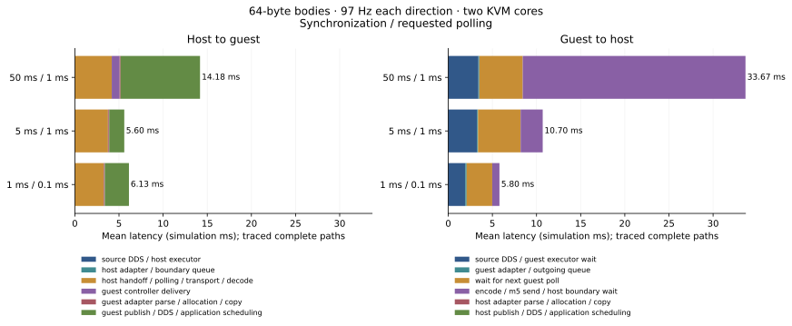
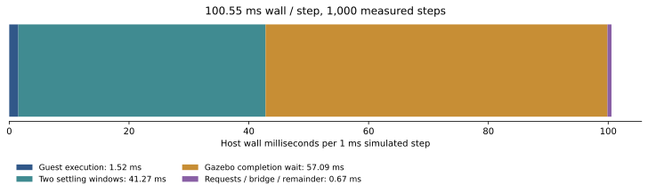

# Chimaera latency profile — 20 October 2026

Most of the small-message delay comes from **guest scheduling, callback queues,
an extra polling cycle, and synchronization-boundary delivery**. Larger messages
also expose a substantial host CPU cost in **gem5's Ruby functional-memory
access path**. The dominant cost depends on whether the objective is simulation
delivery latency, delivery completeness, or wall time to run an experiment.

This investigation inspected the deployed benchmark on `ubuntu-george`, collected
31 new completed cases and 153,333 buffered trace records, and sampled host CPU
stacks for small and large KVM transfers. An initial smoke case also completed.
The deployed service, source checkout and base guest image were not changed.
Temporary profiling containers have been removed; their mounted artifacts remain.

## Comparable uninstrumented measurements

The following controls use 64-byte bodies, independent 97 Hz sources in each
direction, two KVM cores at 3 GHz, reliable depth-128 routes, 1 ms physics steps,
0.2 s warmup, 1 s measurement and 0.4 s drain. Ranges show **two individual run
means**, not confidence intervals. Native controls and the 1 ms synchronization
case each have one run. All measured publications were received in these cases;
actual publication counts were 97–98 per direction per run.

| Mode / synchronization / requested polling | Host → guest mean, simulation ms | Guest → host mean, simulation ms |
| --- | ---: | ---: |
| Native free | 0.619 | 0.629 |
| Native stepped, 5 ms | 0.515 | 0.361 |
| Chimaera, 50 ms / 10 ms | 15.13–16.96 | **169.09–180.05** |
| Chimaera, 50 ms / 1 ms | 11.53–12.03 | 35.50–50.51 |
| Chimaera, 5 ms / 1 ms | 5.38–6.39 | 8.74–11.17 |
| Chimaera, 1 ms / 0.1 ms | 5.060 | 5.766 |

These are fresh-boot cases. The earlier deployed sweeps include different rates,
payloads, windows and reused guest boots, so their numbers should not be treated
as direct before/after comparisons with this table.

Delivery latency starts at **actual publication**. It excludes source release
lag. At 50 ms synchronization the host's mean release lag was another **24.74 ms**;
at 5 ms it was 2.47 ms. A message's age relative to its requested release therefore
can exceed the publish-to-callback latency substantially.

Numerical results: [run-summary.csv](measurements/chimaera-latency-2026-10-20/run-summary.csv).

## Where a received message waits

The instrumented paths join each message's original source and receive records
to its intermediate stages. Each row below uses the **same received-message
cohort throughout**, so its component means add to its total. These are traced
measurements, not estimates obtained by subtracting unrelated percentiles.

**Host → guest, small messages:**

| Sync / poll | Host controller submission → guest batch decoded | Guest controller delivery | Guest adapter parse / allocation / copy | Guest publish entry → application callback | Total | Complete paths / receipts |
| --- | ---: | ---: | ---: | ---: | ---: | ---: |
| 50 ms / 1 ms | 4.182 | 0.885 | 0.111 | **9.002** | 14.180 | 97 / 97 |
| 5 ms / 1 ms | **3.753** | 0.037 | 0.106 | 1.703 | 5.599 | 96 / 97 |
| 1 ms / 0.1 ms | **3.259** | 0.029 | 0.106 | 2.734 | 6.128 | 97 / 97 |

Values are simulation milliseconds. The first component includes controller
handoff, polling phase, transport and batch decoding; it is not a socket-only
measurement. The host-side callback and submission markers have zero logical-time
separation in these cohorts because the host delivery clock is frozen during
that work. They still consume wall time.

The receiving benchmark endpoint explicitly runs `spin_some()`, checks its
source schedule, and sleeps for a requested 1 ms. Consequently, the last column
of component times includes **the benchmark endpoint's own polling and callback
queue**, as well as DDS and OS scheduling. It must not be labeled pure DDS cost
or unavoidable universal-bridge cost. Coarse host clock jumps release message
bursts, which this receiving loop then drains over multiple iterations.

**Guest → host, small messages:**

| Sync / poll | Publication → guest bridge callback | Adapter / outgoing queue | Submitted → next guest batch send | Batch send entry → host bridge delivery | Total | Complete paths / receipts |
| --- | ---: | ---: | ---: | ---: | ---: | ---: |
| 50 ms / 1 ms | 3.418 | 0.103 | 4.918 | **25.234** | 33.673 | 95 / 97 |
| 5 ms / 1 ms | 3.259 | 0.113 | **4.827** | 2.501 | 10.701 | 94 / 97 |
| 1 ms / 0.1 ms | 1.923 | 0.159 | **2.901** | 0.817 | 5.800 | 90 / 97 |

The third component is a real pipeline delay: `run_next()` performs an exchange,
then the guest bridge pumps ROS and submits outgoing messages; those submissions
wait through the **next** sleep before being sent. The fourth component includes
encoding and m5 send work plus the wait until the host publishes at a completed
gem5 boundary. Its roughly 25 ms mean at 50 ms synchronization is consistent with
residual boundary waiting. Host allocation/publication and application delivery
have zero additional logical time in these cohorts.

Full stages and cohort coverage:
[stage-breakdown.csv](measurements/chimaera-latency-2026-10-20/stage-breakdown.csv).

## The guest timer creates a floor and a queueing cliff

An independent pre-measurement guest probe found:

- Running kernel: `5.15.0-142-generic`; this is the guest-reported version, rather
  than a version inferred from the external kernel asset's filename.
- Current clock source: `refined-jiffies`; available sources:
  `refined-jiffies jiffies`.
- Monotonic clock resolution: **0.004 s**; timer resolution: **4,000,000 ns**;
  the timer diagnostic reported high-resolution timers inactive.
- Boot logs report failed TSC calibration and selection of `refined-jiffies`.

| Requested sleep | Observed guest OS duration, all 20 samples |
| --- | ---: |
| 100 µs | 4.000250 ms |
| 500 µs | 4.000250 ms |
| 1 ms | 4.000250 ms |
| 5 ms | 8.000500 ms |
| 10 ms | 12.000750 ms |

Thus decreasing the polling setting from 1 ms to 100 µs does not establish a
100 µs polling cadence in this guest. The bridge and the benchmark endpoint both
use sleep-based loops. The TimingSimpleCPU trace likewise measured 4.000250 ms
mean guest OS time for its requested 1 ms polling sleeps.

At requested 10 ms polling, the saturated small-message traces completed only
76–77 exchanges during the one-second measurement. A 97 Hz source outruns a
subscription serviced once per such poll. In those traces, **183–223 ms** of
the guest-to-host mean was spent before the bridge callback, versus approximately
26 ms from batch-send entry to host boundary delivery. This explains the large
directional asymmetry and growing latency: queued messages dominate.

A source-rate control supports that explanation. Holding 50 ms synchronization
and 10 ms polling fixed, reducing the source to 37 Hz produced 41.24 ms untraced
and 40.45 ms traced guest-to-host means. In that trace the pre-bridge callback
wait was only **4.86 ms**, followed by 11.80 ms waiting for the next poll and
23.71 ms through send/boundary delivery. This is a change in operating load,
not an equivalent-throughput optimization result.

Raw probe: [guest-clock-diagnostics.txt](measurements/chimaera-latency-2026-10-20/guest-clock-diagnostics.txt).
Relevant implementation:
[guest controller](../gem5-transport/src/gem5_guest_controller.cpp),
[guest bridge](../ros/chimaera_ros_ws/src/chimaera_ros_bridge/src/guest_bridge.cpp),
[benchmark endpoint](../ros/chimaera_ros_ws/src/chimaera_ros_bridge/benchmark/endpoint.cpp).

## Wall time is a separate budget

For the traced two-core KVM 1 ms synchronization / 100 µs requested polling case,
1,000 measurement-window steps had the following exclusive wall-time partition:

| Work per 1 ms simulated step | Mean host wall ms |
| --- | ---: |
| gem5 execution/control phase | 1.517 |
| Settle before physics | **20.653** |
| Gazebo control request | 0.391 |
| Gazebo completion/statistics wait | **57.088** |
| Settle after physics | **20.621** |
| Host ingress and egress bridge work | 0.272 |
| Remaining driver/tracing work | 0.004 |
| **Total** | **100.546** |

The two settling windows plus completion/statistics waiting account for about
**97.8%** of this KVM step's wall time. These paused intervals do not advance the
benchmark's simulation delivery clock. Removing wall-clock waiting therefore
must not be reported as an equal reduction in simulated message latency.

An independent observer watched the existing shared physics clock, without
modifying its plugin. In 95 measurement-window steps, it first observed the final
requested `PreUpdate` time an average **3.42 ms** after the control-request marker;
the completion marker arrived another **54.17 ms** later. Observation can be
delayed by host scheduling, and `PreUpdate` precedes completion of the final
physics update. This establishes a large notification gap; it does not justify
removing verification of iteration/time completion.

For the short **TimingSimpleCPU** trace at 5 ms synchronization, the partition
changes substantially: 1,314.43 ms wall per step, including **1,215.52 ms in the
gem5 phase** across 30 measured steps. Detailed CPU execution dominates that
case. The KVM wall-time percentages should not be generalized to detailed CPUs.

Evidence: [wall-phases.csv](measurements/chimaera-latency-2026-10-20/wall-phases.csv).

## Bulk transfers: functional-memory traversal is expensive

The 300 KiB / 97 Hz bidirectional control and trace both received every measured
publication. The untraced means were 38.33 ms host → guest and 31.20 ms guest →
host; the traced means were 29.13 and 33.50 ms. One pair is insufficient to rank
small differences or attribute an absolute instrumentation cost.

A host-only `cycles:Hu` sample during the large-payload original-runtime case
contained 2,014 samples and decoded with zero reported lost samples. Approximately
73.2% of sampled active cycles were inside gem5 proper. Leading **self** symbols
included:

| Symbol | Share of sampled host user cycles |
| --- | ---: |
| `ruby::MessageBuffer::functionalAccess` | 22.49% |
| `ruby::Switch::functionalWrite` | 4.12% |
| `ruby::CacheMemory::findTagInSet` | 4.11% |
| `ruby::SimpleNetwork::functionalWrite` | 3.23% |

The source explains the hotspot. Chimaera m5 send/receive calls use
`TranslatingPortProxy::readBlob` / `writeBlob`. `PortProxy` splits transfers into
cache-line-sized functional packets. Ruby functional writes search controller
buffers, caches, sequencers and network structures. With the configured 64-byte
cache line, 300 KiB requires at least **4,800 functional chunks**; one 640×480 RGB
image requires **14,400**, before framing and alignment. This is substantial
simulator work beyond copying bytes through a Unix socket.

The bridge also has at least four explicit full-payload copies for an ordinary
delivered route: route framing, controller batch encoding, batch decoding and
creation of the ROS serialized publish buffer. Stereo pairing adds another
packing copy. DDS and m5's simulator/guest transfer add work beyond those copies.

For small KVM messages, measured guest encode/decode spans were typically tens
of microseconds and framed m5 send/receive spans around 0.1 ms each. Those spans
include instrumentation and are not pure syscall costs. In the large-payload
trace, the host gem5 phase averaged 99.66 ms per 50 ms simulated step, versus
36.44 ms for the representative small-message trace. The separate host CPU
profile identifies the functional-memory path as a bulk-transfer optimization
target; it does not turn host CPU cycles into simulated latency.

Each ordinary controller poll also performs two m5 send calls and two m5 receive
calls, with a fresh Unix connection per call, even for empty controller batches.
Persistent connections and fewer framing operations are plausible later targets,
but the small-message queueing delays and the bulk functional-memory hotspot
provide stronger evidence for the first changes.

The small-message CPU capture had only 366 samples: about 53.1% of sampled active
cycles were in Python and 31.3% in gem5. It sampled a simulator whose wall time was
mostly waiting; these percentages are not shares of total experiment time.
The large capture command returned status 241 after saving its data; the saved
profile decoded successfully. Both captures serve as hotspot evidence, not
precise CPU budgets. No TimingSimpleCPU CPU-stack capture is claimed.

Source:
[m5 operations](../gem5/src/sim/pseudo_inst.cc),
[PortProxy](../gem5/src/mem/port_proxy.cc),
[Ruby functional writes](../gem5/src/mem/ruby/system/RubySystem.cc),
[bridge framing](../ros/chimaera_ros_ws/src/chimaera_ros_bridge/include/chimaera_ros_bridge/bridge.hpp).

## Ball-catching traffic loses messages at multiple local hops

This profile follows the deployed 30 Hz camera workload: two 640×480 RGB images,
250 Hz joint feedback, 250 Hz effort commands and 1,000 Hz clock messages.
Synchronization was 5 ms, requested polling 1 ms, with 0.2 s warmup, 1.5 s
measurement and 0.4 s drain. It is synthetic traffic without perception or
control computation, and differs from the repository preset's 90 Hz cameras.

The traced run observed the following progress for actual measurement-window
publications:

| Stream | Published | Source bridge callback | Controller submitted | Transfer reached destination bridge | Destination ROS publish entry | Application callback |
| --- | ---: | ---: | ---: | ---: | ---: | ---: |
| Left image | 45 | 36 | 32 | 32 | 32 | 18 |
| Right image | 45 | 36 | 32 | 32 | 32 | 18 |
| Joint feedback | 375 | 300 | 300 | 300 | 300 | 299 |
| Effort command | 375 | 289 | 289 | 289 | 289 | 245 |
| Clock | 1,500 | 311 | 301 | 258 | 258 | 256 |

These are observations by the drain cutoff, not proof that every absent message
was permanently dropped. No measured stereo pair was rejected by the bridge's
age check in this traced run.

Joint feedback illustrates the early loss clearly. The host source produced
225 single-message boundaries and 75 two-message boundaries: 375 publications
over 300 distinct 5 ms logical times. Only 300 reached the depth-one bridge
subscription, consistent with replacement during bursts. All 300 then survived
the instrumented transport path through guest ROS publication. Faster socket
handling cannot recover publications that never reached the adapter callback.

For each camera, nine publications were absent before the source adapter callback,
another four did not reach controller submission, and fourteen of the 32 guest
republishes were absent at the application callback. Clock messages were reduced
both before the adapter and by the configured coalescing/controller path. Effort
commands also had losses before the adapter and after destination publication.

Camera delivery varied strongly: the untraced run received only 3/45 left and
2/45 right frames, versus 18/45 each in the trace. Existing five-second deployed
runs also show sparse and variable camera delivery. These short cases establish
where to instrument next; they do not establish stable image-loss probabilities
or show that tracing improves delivery. Per-stream latency describes survivors.

Evidence: [pipeline-counts.csv](measurements/chimaera-latency-2026-10-20/pipeline-counts.csv).

## What to change first

| Priority | Experiment / change to evaluate | Evidence and expected benefit |
| --- | --- | --- |
| 1 | Establish a valid guest high-resolution time source/timer configuration; add an event-driven receiving-endpoint control | The 4 ms timer floor affects both bridge polling and the benchmark endpoint. This separates benchmark receiver behavior from bridge overhead. |
| 2 | Drain available guest callbacks adequately and evaluate sending newly collected outgoing data without another sleep | The 10 ms setting falls below the source service rate; the extra outgoing poll costs approximately 3–5 ms in representative fine-sync traces. |
| 3 | Evaluate smaller delivery sub-boundaries and explicit completion notifications | The 50 ms boundary contributes approximately 25 ms guest → host waiting. Finer coupling currently pays around 100 ms wall per step. Preserve causal ordering and verified simulator completion. |
| 4 | Make queue policies, burst behavior and delivery completeness part of the comparison | Depth-one subscriptions discard samples before transport; camera losses also occur after republishing. Larger queues can exchange loss for latency rather than reduce overhead. |
| 5 | Reduce bulk functional-memory work and redundant full-payload copies; then evaluate connection/framing reuse | Ruby functional traversal dominates the large-payload host CPU profile. Any faster path must preserve guest-memory and coherence semantics, especially for detailed CPUs. |

The step-settling windows should be replaced only with a measured readiness or
completion condition that preserves their purpose. Blindly deleting sleeps or
completion checks would change the experiment's semantics.

## Confidence, provenance and reproduction

The strongest findings are the directly probed timer quantization, the location
of callback queueing, the extra outgoing poll, the exclusive wall-time partition,
the observed pipeline counts and the bulk CPU hotspot. Precise component values
remain exploratory:

- **Tracing perturbs execution.** At 50/10 ms, traced guest → host means were
  221–261 ms versus 169–180 ms untraced. Queue saturation amplifies small changes.
  Rebuilt tracing-off controls at 5/1 ms gave 4.63 / 8.02 ms in the two directions;
  at 50/1 ms, 12.24 / 31.44 ms. Tracing changes timing and phase, not just a
  constant additive cost.
- **Two-core KVM clocks have fine ordering limitations.** Twenty-three received
  paths had backwards intermediate timestamps and were excluded from component
  attribution, without clamping them. The representative 50/1 ms guest → host
  cohort excluded two paths, with maximum backwards movement 0.187 ms. KVM uses
  separate CPU event queues and a 1 ms simulation quantum in the standard
  processor implementation. This is consistent with cross-core timing skew;
  it is not evidence of a negative physical transfer. One-core verification
  paths had no such exclusions. All end-to-end receipts remain in run summaries.
- **Detailed CPU verification is small.** One-core TimingSimpleCPU at 3 GHz,
  16 KiB L1 caches and 256 KiB L2 completed with 14 / 15 receipts. Its untraced
  means were 6.01 / 5.93 ms and traced means 2.29 / 10.07 ms. The traced guest →
  host path comprised 3.28 ms before the adapter, 3.67 ms to the next poll,
  3.11 ms through send/boundary delivery and 0.017 ms adapter work. This verifies
  the mechanisms on a detailed CPU, not stable CPU-model comparisons or image
  performance. Origin metadata confirms `BaseTimingSimpleCPU` was active.
- **The host was shared.** `ubuntu-george` has six i5-9600K cores. Existing robot
  experiments continued running. The profiling container had a two-CPU quota
  and 3 GiB memory limit; the temporary sampler had a 0.25-CPU quota. Wall-time
  results and KVM scheduling vary with host load. No global timer/perf setting
  was changed.
- **Clock and sample limits matter.** Native timestamps have 1 ms physics-clock
  granularity. Most new synthetic cases have about 97 receipts per direction,
  rather than enough observations for a stable p99. Aggregate source-rate and
  per-stream delivery counts accompany every latency statistic.

The existing deployment contained 71 attempts: 67 complete, two failed and two
interrupted. Three "complete" reused-boot cases had **zero guest publications**:
`85c61a4a2f65453996d50922a12e779a/case_0009`, the same sweep's `case_0013`, and
`5d7c4a72b12544ae96fbc6f6dd891f9e/case_0005`. Their empty guest measurements are
excluded from latency conclusions. Future benchmark validity checks should
require advancing sources and useful delivery, in addition to complete telemetry.

The deployed runtime is version 4, newer than this checkout's version-3 benchmark.
Profiling used a copied source snapshot from the deployed container, rather than
replacing it with this checkout. The base image was
`sha256:642cd426444f5fe6e0ba2c586ca94937e744590b74511c6a55640b657ec35e93`;
gem5 SHA-256 was
`ae17d8a2a43951693951773da7c5e22a237855d5234eabc48c13d1f30db519ce`.
Every case retains parameters, commands, runtime/bundle hashes, source/receive
events, origin/configuration, logs and profiling provenance. Base disk and kernel
mounts were read-only; guest installation used temporary copy-on-write layers.

Validation passed all **11 deployed-package CTest targets** and the profiling
analysis checks, including a real C++ trace/identity round trip. All 31 planned
new cases completed. No production optimization was applied.

Reproducible tools and clock contracts:
[profiling/chimaera_latency](../profiling/chimaera_latency/README.md).
The full numerical export is
[analysis.json](measurements/chimaera-latency-2026-10-20/analysis.json);
[existing-summary.csv](measurements/chimaera-latency-2026-10-20/existing-summary.csv)
retains the deployed sweep statistics. Artifact hashes and capture details are in
[provenance.json](measurements/chimaera-latency-2026-10-20/provenance.json).

Raw traces, serial logs, source snapshot and CPU samples are retained locally in
the ignored `.chimaera-profile/20261020/` directory and remotely under
`/home/kkgiorgos/Chimaera/.chimaera-profile/20261020/` on `ubuntu-george`.
The scientific figures are also exported as PNG and standalone SVG beside the
CSV evidence.
